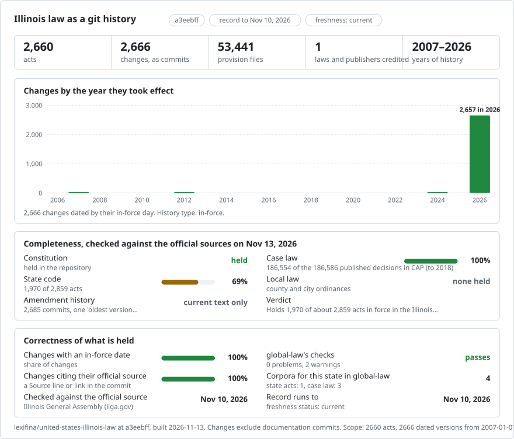

# United States (Illinois): law history in git

<picture>
<source media="(prefers-color-scheme: dark)" srcset="data/effort-dark.svg">

</picture>

Part of [lexifina/global-law](https://github.com/lexifina/global-law), one git history for every country's law: this is the law of Illinois, United States, which global-law reads at `united-states/illinois/acts/`.

The law of Illinois as a git history: one file per provision, with `git blame` and `git log` working line by line. It follows the shared design of [lexifina/global-law](https://github.com/lexifina/global-law).

**What is in it now (a first build, not complete)**

| Folder | Act | Versions | History |
| --- | --- | ---: | --- |
| `constitution-*/` | Constitution of the State of Illinois (1970): the preamble, one folder per article, and the transition schedule | 1 | 139 provisions, text as read on 2026-01-01 |
| `ilcs-<chapter>-<act>[-article-NNNN]/` | Illinois Compiled Statutes: 1968 of the 2859 acts in force that the 72 chapter act lists name (one folder per act, or per article of a large act) | 1-2 | 50633 sections; each act dated by the day of the capture read (2024-12-22 to 2026-10-31) |

English. Only statute and Constitution text and the compilation's own "(Source: ...)" lines are taken.

## Dates

The General Assembly's pages carry the current text only. Each act is therefore one version, "oldest version available". The first build's articles of the Criminal Code of 2012 are dated 2024-12-22, the file date of the /ftp/ILCS/ files; acts read from the 2025 site are dated by the day of the Internet Archive capture read (the newest since 1 January 2025). The Constitution is dated 2026-01-01, the day of the capture read; it was adopted on 1970-12-15 and the text is as amended to that capture. Later builds will add later versions on top.

## How it is checked

Every version is read back from git on the day it took effect and on the day before (`tools/check_repo.py`) and must match `corpus.json`; the results are in `REPRODUCE.md`.

## What "author" means

The author of a commit is the law that made the change, with an e-mail address that cannot exist (`<law key>@ilga.gov.invalid`). In this first build no dated history is available, so every commit is credited to the publisher as "oldest version available". The committer is always Lexifina.

## Limits

1968 of the 2859 acts in force listed by the General Assembly are included. An act is included only when its page (or, for a large act, its full text or every article page) has a capture holding section text. Acts marked repealed or renumbered are not read. Left out so far: large act: no capture of its full text or of every article page (98); no section text on the page (527); no capture (217); large act: a page without section text (49). The Public Acts and administrative rules are not included. There is no history before the dates above.

## Archive additions

This partial rebuild uses Internet Archive captures of Illinois General Assembly pages. The existing coverage record above is retained; two additional listed acts are included below. Remaining gaps include uncaptured or incomplete text, undatable text, and source pages with alternative versions.

| Act | Sections | Source effective date | Capture |
| --- | ---: | --- | --- |
| Secretary of State Buildings in Cook County Act (15 ILCS 330) | 4 | 2007-01-01 | [20251207055418](https://web.archive.org/web/20251207055418id_/https://ilga.gov/Legislation/ILCS/Articles?ActID=203&ChapterID=4&Print=True) |
| Comptroller's Records Act (15 ILCS 415) | 7 | 2012-08-10 | [20251009230622](https://web.archive.org/web/20251009230622id_/https://ilga.gov/Legislation/ILCS/Articles?ActID=207&ChapterID=4&Print=True) |

These added current-text versions are dated by the latest explicit effective date in the compilation's own amendment notes. Capture timestamps identify the source snapshots. No earlier wording is reconstructed.

## ILCS static compilation additions

The [Illinois General Assembly static ILCS compilation](https://ftp.ilga.gov/ILCS/) is dated 30 October 2026, through Public Act 104-854. Its publisher states: “The only official copy of the law is the printed copy maintained by the Secretary of State’s office.” The provisions “have NOT been edited for publication, and are NOT in any sense the 'official' text”. The publisher says this copy should not be cited as official or authoritative.

Of the locally available compilation, 49 complete indexed acts have identifiers already represented in published records. Their static source text includes every section, act title and article heading in the publisher’s source index, in its Section Sequence. These static copies were validated separately; this update does not assert that the existing published versions equal those copies. Five other complete acts contain future-effective text and are held. No additional law version is included in this documentation update. The remaining static compilation is incomplete in the material available for this record.

Current-text preparation uses the latest explicit effective date in the source amendment notes. Where there is no explicit section effective date, they use the publisher’s compilation update date, 30 October 2026. Individual section source URLs and byte digests are recorded in `data/ilcs-static-additions.json` when additions are available. Source pages containing future-effective text or normative images are held. No earlier wording is reconstructed. Existing records above retain their historical date labels.
